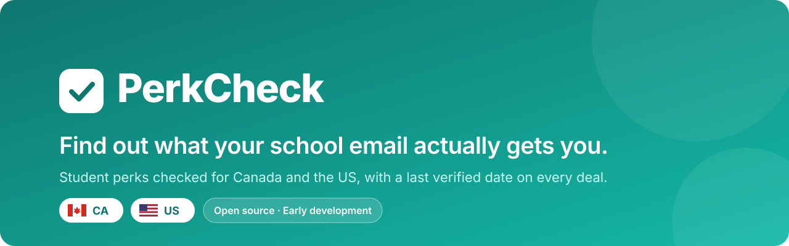
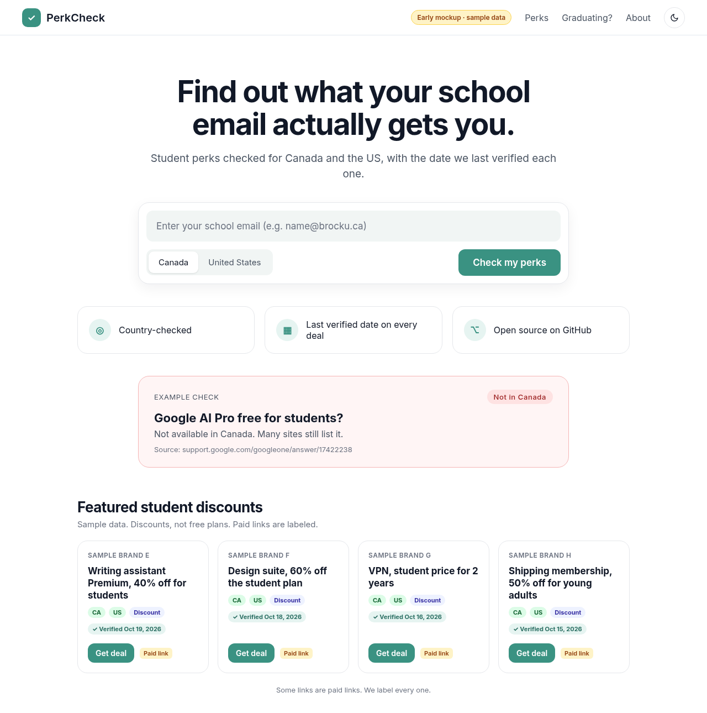
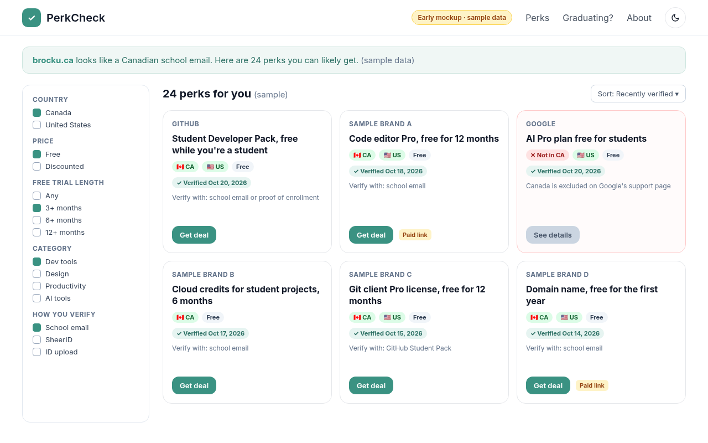
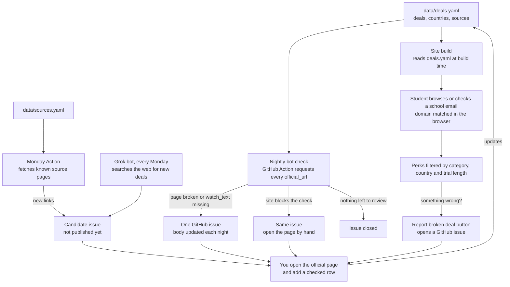

  

  
  
  

  <a href="#-why-this-exists">Why</a> •
  <a href="#-features">Features</a> •
  <a href="#%EF%B8%8F-how-it-works">How it works</a> •
  <a href="#-contributing">Contribute</a>

<h3 align="center">Student perks that actually work for <i>you</i>. Checked by country 🇨🇦 🇺🇸 and school email ✉️, with a date on every deal.</h3>

<a href="https://ayaanrathod.github.io/verified-student-perks/"><b>Open the live site</b></a>

> [!NOTE]
> **[PerkCheck](https://ayaanrathod.github.io/verified-student-perks/) is live.** Browse the catalog by category, search and filter, then check a school email in the browser. 103 deals are hand-checked. A card names the country fit after that email check. Nothing is stored.

---

## 🤔 Why this exists

Most student deal lists are written for US students and rarely say which countries a deal covers. Canadian students often find out **after** signing up.

> [!IMPORTANT]
> **Real example:** many deal sites list Google's free AI Pro plan for students, but Google's own support page says it's [**not available in Canada**](https://support.google.com/googleone/answer/17422238).

PerkCheck tags every deal with where it's **confirmed** to work, links the official source, and shows when it was last checked.

---

## ✨ Features

<table>
  <tr>
    <td width="33%" valign="top">
      <h3>📚 Browse first</h3>
      Sticky categories, shelves, search, filters and shareable links. GitHub Pack is a filter, not a fake category.
    </td>
    <td width="33%" valign="top">
      <h3>✉️ Email checker</h3>
      Type your school email and see the perks recorded for that school. Runs in your browser, and nothing is stored.
    </td>
    <td width="33%" valign="top">
      <h3>🇨🇦 Country tags</h3>
      Every deal is marked CA and/or US, with a clear <b>Not in CA</b> badge and a source when it's excluded.
    </td>
  </tr>
  <tr>
    <td valign="top">
      <h3>✅ Last verified date</h3>
      Every deal shows when it was last checked.
    </td>
    <td valign="top">
      <h3>🤖 Nightly bot</h3>
      A GitHub Action opens every deal page each night. One issue lists broken pages, missing watch text, and sites that block the check.
    </td>
    <td valign="top">
      <h3>🏷️ Honest paid links</h3>
      Any affiliate link has a <b>Paid link</b> label right next to it. Always.
    </td>
  </tr>
</table>

---

## 📸 Sneak peek

<i>Live site: <a href="https://ayaanrathod.github.io/verified-student-perks/">ayaanrathod.github.io/verified-student-perks</a></i>

  
  

---

## ⚙️ How it works

<table>
  <tr>
    <td align="center" width="25%"><h3>1️⃣</h3><b>Data</b> Every deal lives in one public file, <code>deals.yaml</code></td>
    <td align="center" width="25%"><h3>2️⃣</h3><b>Nightly check</b> GitHub Actions opens each official page. One issue lists broken pages, text changes, and sites to open by hand</td>
    <td align="center" width="25%"><h3>3️⃣</h3><b>Monday search</b> The Grok bot searches for new deals. Actions watches the source list for new links</td>
    <td align="center" width="25%"><h3>4️⃣</h3><b>You check</b> Browse the catalog, or enter your email for perks that fit you</td>
  </tr>
</table>

<b>🔍 See the full flow diagram</b>

 

- **Email check:** the site matches your email's domain (like `brocku.ca`) against [Hipo/university-domains-list](https://github.com/Hipo/university-domains-list) at commit [`603e10f51b67c6553b9bca9aecc0db4c2417ed10`](https://github.com/Hipo/university-domains-list/tree/603e10f51b67c6553b9bca9aecc0db4c2417ed10), right in your browser. Each brand's own verifier makes the final call.
- **Reports:** every deal gets a **Report broken deal** button that opens a GitHub issue.
- **No database:** the site is built straight from `deals.yaml`.

---

## 🛠️ How this was built

A small static site, a public deal file, and careful checking. AI tools helped with speed. The decisions, the data and the review stayed human.

| 🧠 What matters here | 🔁 How it stays honest |
|---|---|
| Data design and eligibility rules | Validation before publish |
| Checking deals on official pages | Small, reviewed changes |
| Clear country and school-email tags | Nightly link checks and a DEVLOG |

<b>🧰 Tech stack</b>

 

  
  
  
  

Plain HTML, CSS and JavaScript in `docs/` on GitHub Pages, Python scripts, GitHub Actions, and YAML.

School domain data comes from [Hipo/university-domains-list](https://github.com/Hipo/university-domains-list) at commit [`603e10f51b67c6553b9bca9aecc0db4c2417ed10`](https://github.com/Hipo/university-domains-list/tree/603e10f51b67c6553b9bca9aecc0db4c2417ed10).

<b>📄 Deal data format</b>

 

Deals live in `data/deals.yaml`. See [`data/deals.example.yaml`](data/deals.example.yaml) for samples.

| Field | Required | Meaning |
|---|---|---|
| `id` | yes | Short unique slug, e.g. `github-student-pack` |
| `brand` | yes | Brand name |
| `title` | yes | One-line benefit |
| `about` | no | One sentence on what the product is. Shown on each card |
| `category` | yes | `github-pack`, `ai`, `coding`, `cloud`, `design`, `notes`, `learning`, `shopping` |
| `github_pack` | no | `true` when the perk is part of the GitHub Student Developer Pack |
| `featured` | no | `true` or `false`. At most 4 deals in the file may be featured |
| `featured_rank` | no | Positive whole number. Only when `featured` is `true` |
| `price_type` | yes | `free` or `discount` |
| `free_months` | no | Length of the free period in months |
| `discount` | no | e.g. `50% off` |
| `countries` | yes | Countries confirmed to work, e.g. `[CA, US]` |
| `not_available_in` | no | Countries confirmed not to work, each with a source |
| `verification` | yes | `school-email`, `sheerid`, `unidays`, `student-beans`, `id-upload`, `github-education`, `other` |
| `email_rules` | no | Notes such as "any school-issued email" |
| `ca_school_email` | yes | `accepted`, `rejected`, or `unknown`. `accepted` means a Canadian university `.ca` email can be used. Active deals cannot be `unknown`. |
| `ca_school_email_source` | when accepted | https page that shows a Canadian school email works |
| `schools` | no | Limit the deal to these lowercase email domains |
| `how_to_claim` | yes | 3 to 5 short steps |
| `official_url` | yes | The brand's own page, never an aggregator |
| `affiliate_url` | no | Paid link, shown with a "Paid link" label |
| `source_note` | yes | Where the eligibility info came from |
| `last_verified` | yes | Date checked, `YYYY-MM-DD`. When a site blocks the bot and this date is more than 30 days old, the night check marks it due for a hand check |
| `watch_text` | no | Phrase that must stay on the official page. If the page loads and the phrase is missing, the night check reports a text change |
| `status` | yes | `active`, `needs-review`, `expired` |
| `logo` | no | File name in `docs/logos/`, or null |
| `banner_color` | yes for active | Banner background, `#RRGGBB` |
| `logo_color` | no | Fill for a single-colour logo, `#RRGGBB` |

---

## ✅ What shipped

- [x] Deal file, validation, nightly link check, Monday source watch, Grok candidate inbox
- [x] 103 hand-checked deals
- [x] Email check, filters, deal pages, and the live GitHub Pages site
- [x] Browse by category with shelves, search, filters and shareable URLs
- [x] **Report broken deal** button that opens a GitHub issue

The catalog stays useful as long as the data is kept honest. Small fixes and deal updates are still welcome.

---

## 🤝 Contributing

No code needed to help:

- 💡 **Suggest a deal:** open an issue with the brand, what students get, the countries and the official link
- 🚩 **Report a broken deal:** open an issue with the deal `id` and what changed
- ✏️ **Fix data:** edit `data/deals.yaml` and open a PR with the official source

More in [CONTRIBUTING.md](CONTRIBUTING.md).

---

