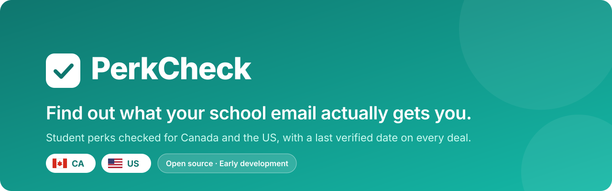
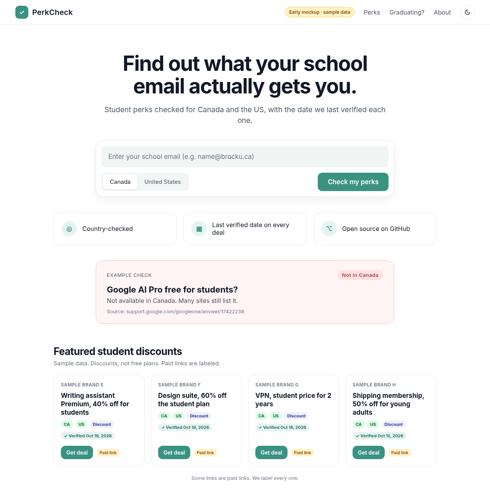
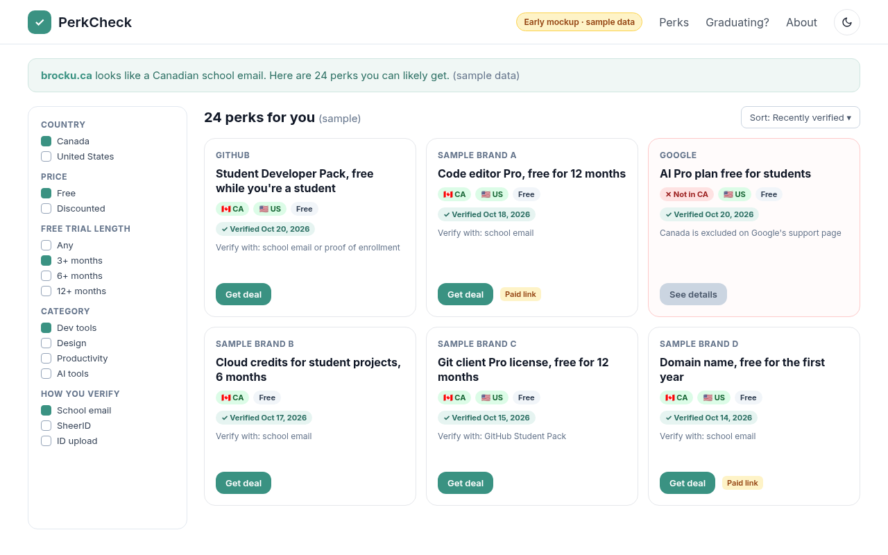
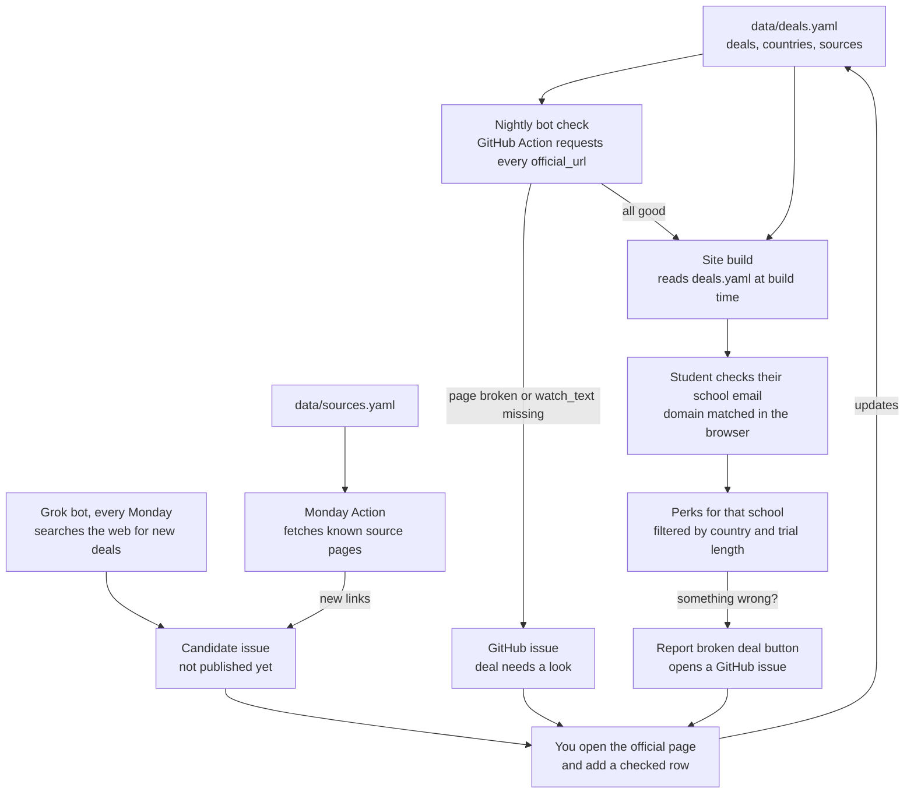

  

  
  
  
  

  <a href="#-why-this-exists">Why</a> •
  <a href="#-features">Features</a> •
  <a href="#%EF%B8%8F-how-it-works">How it works</a> •
  <a href="#-roadmap">Roadmap</a> •
  <a href="#-contributing">Contribute</a> •
  <a href="#-if-youre-a-recruiter-reading-this">Recruiters</a>

<h3 align="center">Student perks that actually work for <i>you</i>. Checked by country 🇨🇦 🇺🇸 and school email ✉️, with a date on every deal.</h3>

<a href="https://ayaanrathod.github.io/verified-student-perks/"><b>Open the live site</b></a>

<b>⭐ If this looks useful, a star helps other students find it.</b>

> [!NOTE]
> **The site is live.** [PerkCheck](https://ayaanrathod.github.io/verified-student-perks/) checks a school email in the browser. 13 deals are hand-checked. The goal is 30 to 50.

---

## 🤔 Why this exists

Most student deal lists are written for US students and rarely say which countries a deal covers. Canadian students often find out **after** signing up.

> [!IMPORTANT]
> **Real example:** many deal sites list Google's free AI Pro plan for students, but Google's own support page says it's [**not available in Canada**](https://support.google.com/googleone/answer/17422238).

PerkCheck tags every deal with where it's **confirmed** to work, links the official source, and shows when it was last checked.

---

## ✨ Features

<table>
  <tr>
    <td width="33%" valign="top">
      <h3>✉️ Email checker</h3>
      Type your school email and see the perks recorded for that school. Runs in your browser, and nothing is stored.
    </td>
    <td width="33%" valign="top">
      <h3>🇨🇦 Country tags</h3>
      Every deal is marked CA and/or US, with a clear <b>Not in CA</b> badge and a source when it's excluded.
    </td>
    <td width="33%" valign="top">
      <h3>⏳ Trial-length filter</h3>
      Find perks free for 3, 6 or 12+ months, and filter free vs discounted.
    </td>
  </tr>
  <tr>
    <td valign="top">
      <h3>✅ Last verified date</h3>
      Every deal shows when it was last checked.
    </td>
    <td valign="top">
      <h3>🤖 Nightly bot</h3>
      A GitHub Action re-checks every deal page each night and flags anything broken.
    </td>
    <td valign="top">
      <h3>🏷️ Honest paid links</h3>
      Any affiliate link has a <b>Paid link</b> label right next to it. Always.
    </td>
  </tr>
</table>

The email checker, country tags, trial filter, last-verified date, nightly check, and paid-link label are in the project today.

---

## 📸 Sneak peek

<i>The live site is <a href="https://ayaanrathod.github.io/verified-student-perks/">ayaanrathod.github.io/verified-student-perks</a>. These pictures are the early layout. Students use the site in <code>docs/</code>.</i>

  
  

---

## ⚙️ How it works

<table>
  <tr>
    <td align="center" width="25%"><h3>1️⃣</h3><b>Data</b> Every deal lives in one public file, <code>deals.yaml</code></td>
    <td align="center" width="25%"><h3>2️⃣</h3><b>Nightly check</b> GitHub Actions opens each official page and flags anything broken</td>
    <td align="center" width="25%"><h3>3️⃣</h3><b>Monday search</b> The Grok bot searches for new deals. Actions watches the source list for new links</td>
    <td align="center" width="25%"><h3>4️⃣</h3><b>You check</b> Enter your email and get perks that fit you</td>
  </tr>
</table>

<b>🔍 See the full flow diagram</b>

 

- **Email check:** the site matches your email's domain (like `brocku.ca`) against [Hipo/university-domains-list](https://github.com/Hipo/university-domains-list) at commit [`603e10f51b67c6553b9bca9aecc0db4c2417ed10`](https://github.com/Hipo/university-domains-list/tree/603e10f51b67c6553b9bca9aecc0db4c2417ed10), right in your browser. A result names the school and how that deal was checked. Each brand's own verifier makes the final call.
- **Reports:** every deal gets a **Report broken deal** button that opens a GitHub issue.
- **No database:** the site is built straight from `deals.yaml`.

---

## 🛠️ How I'm building this

I'm building this myself and treating it like a real product, not a weekend demo. I use AI tools like Cursor the way most developers do today, to move faster. **The decisions, the data and the review are mine.**

| 🧠 I own | 🔁 How I work |
|---|---|
| The data design and eligibility rules | Data and validation first |
| Checking every deal on its official page | Small, reviewed pull requests |
| Reviewing and understanding every change | Tests for the deal file, the link check, and the Monday watch |
| The architecture: a simple static site | Weekly notes in [DEVLOG.md](DEVLOG.md) |

<b>🧰 Tech stack</b>

 

  
  
  
  

Built today: plain HTML, CSS and JavaScript in `docs/` on GitHub Pages, Python scripts, GitHub Actions, and YAML.

**Planned:** Move to Astro and Netlify when I'll add school pages and paid links.

School domain data comes from [Hipo/university-domains-list](https://github.com/Hipo/university-domains-list) at commit [`603e10f51b67c6553b9bca9aecc0db4c2417ed10`](https://github.com/Hipo/university-domains-list/tree/603e10f51b67c6553b9bca9aecc0db4c2417ed10).

<b>📄 Deal data format</b>

 

Deals live in `data/deals.yaml`. See [`data/deals.example.yaml`](data/deals.example.yaml) for samples.

| Field | Required | Meaning |
|---|---|---|
| `id` | yes | Short unique slug, e.g. `github-student-pack` |
| `brand` | yes | Brand name as text (no logos) |
| `title` | yes | One-line benefit |
| `category` | yes | `dev-tools`, `design`, `productivity`, `music-video`, `ai-tools`, `shopping` |
| `price_type` | yes | `free` or `discount` |
| `free_months` | no | Length of the free period in months |
| `discount` | no | e.g. `50% off` |
| `countries` | yes | Countries confirmed to work, e.g. `[CA, US]` |
| `not_available_in` | no | Countries confirmed not to work, each with a source |
| `verification` | yes | `school-email`, `sheerid`, `unidays`, `student-beans`, `id-upload`, `github-education`, `other` |
| `email_rules` | no | Notes such as "any school-issued email" |
| `ca_school_email` | yes | `accepted`, `rejected`, or `unknown`. `accepted` means a Canadian university `.ca` email can be used. Active deals cannot be `unknown`. |
| `how_to_claim` | yes | 3 to 5 short steps |
| `official_url` | yes | The brand's own page, never an aggregator |
| `affiliate_url` | no | Paid link, shown with a "Paid link" label |
| `source_note` | yes | Where the eligibility info came from |
| `last_verified` | yes | Date checked, `YYYY-MM-DD` |
| `watch_text` | no | Phrase the bot watches for on the official page |
| `status` | yes | `active`, `needs-review`, `expired` |

---

## 🗺️ Roadmap

- [x] **Week 1:** deal file, validation, nightly link check, Monday source watch, Grok candidate inbox
- [ ] **Still open:** 30 to 50 hand-checked deals. 13 are checked.
- [x] **Week 2:** email check, filters, deal pages, and the live GitHub Pages site
- [x] **Report broken deal** button. It opens a GitHub issue.
- [ ] **Week 3, still open:** weekly review
- [ ] **Later:** "Graduating soon?" guide, deal changelog, more countries, free listings for student-run businesses and clubs

---

## 💚 How this project keeps going

| | |
|---|---|
| ⭐ **Stars and shares** | The best support if it helps you |
| 🤝 **Contributions** | Every merged PR is credited to you and shows on your GitHub contribution graph |
| 🏷️ **Labeled paid links** | Small commissions at no cost to you, and they never affect rankings |
| 🎓 **Free student listings** | Later, free spots for student-run businesses, clubs and projects |

---

## 🫣 Honest status

> **Users: 0 · Stars: 0 · Contributors: 0**
>
> I'm starting from nothing, with no audience and no followers, and building it anyway. If it takes off, great. If it flops, I still end up with a real project I designed, built, tested and shipped, plus a [DEVLOG](DEVLOG.md) of what I learned. Either way, it gets built.

---

## 🤝 Contributing

No code needed to help:

- 💡 **Suggest a deal:** open an issue with the brand, what students get, the countries and the official link
- 🚩 **Report a broken deal:** open an issue with the deal `id` and what changed
- ✏️ **Fix data:** edit `data/deals.yaml` and open a PR with the official source

More in [CONTRIBUTING.md](CONTRIBUTING.md).

---

## 👋 If you're a recruiter reading this

**Hi! Thanks for scrolling this far. Most people don't.** 😄

I'm **Ayaan**, a new Computer Science grad from Brock University in Ontario, looking for my first full-time role in **software development, IT or business analysis**. This repo shows how I work:

- 🎯 I start from a real problem and check the facts before building
- 🧱 I design the data and system first, then build in small tested pieces
- 📓 I document my decisions and my mistakes in public
- 🤖 I use AI tools to move faster, and I can explain every line that ships

If that sounds like someone you'd want on your team, let's chat. Find me on [GitHub](https://github.com/AyaanRathod) and I'll happily walk you through this project.

---

<b>Affiliate disclosure:</b> PerkCheck is free. Some links may be paid links, and each one is labeled. Paid links never affect which deals are listed or how they're verified. Logos are shown only to identify each deal and belong to their owners. No endorsement is implied.

MIT © 2026 Ayaan Rathod · Made with ☕ in Ontario 🇨🇦

