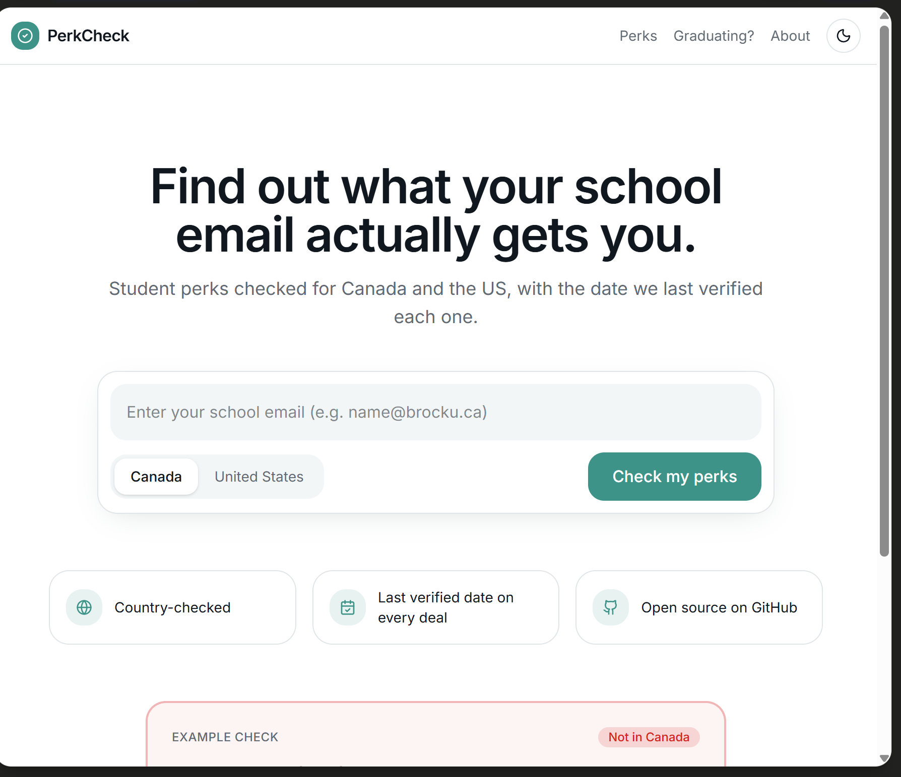
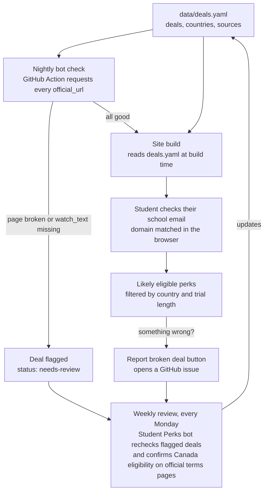

  

  
  
  
  

> **PerkCheck** is a placeholder name. This project is in early development: nothing below is live yet unless it is checked off in the roadmap.

PerkCheck is a free, open source website that will tell students in Canada and the US which student perks actually work for them, based on their country and school email. Every deal will show the date it was last verified and a link to the brand's official page. The deal data lives in this repo as a plain YAML file, a bot will re-check every link each night, and anyone can suggest or fix a deal through a GitHub issue or pull request.

## Why this exists

Most student deal lists are written for US students and rarely say which countries an offer covers. Canadian students often find out only after signing up.

One example: Google's free Google AI Pro plan for students is listed on many deal sites, but Google's own support page lists Canada as a country where the offer is not available ([source](https://support.google.com/googleone/answer/17422238)). PerkCheck tags every deal with the countries it is confirmed to work in, links the official source, and shows when it was last checked.

## Features

Everything here is planned. Items get checked off only when they ship.

- [ ] **"Does my email work?" checker**: enter your school email and pick Canada or the US to see perks you are likely eligible for
- [ ] **Country tags on every deal**: confirmed CA and/or US, plus a clear "Not in CA" badge with a source when a deal excludes Canada
- [ ] **Trial-length filter**: 3+, 6+ or 12+ months free, and free vs discounted
- [ ] **"Last verified" date** on every deal, plus a public changelog
- [ ] **Nightly link check** with a GitHub Action that flags broken or changed deal pages
- [ ] **Weekly review** of flagged deals against official terms pages
- [ ] **"Report broken deal" button** on each deal that opens a pre-filled GitHub issue
- [ ] **"Graduating soon?" guide**: what you lose when you graduate, and when
- [ ] **Labeled paid links**: every affiliate link shows "Paid link" right next to it

## Screenshots

The images below are an **early mockup** with sample data. Brand names are shown as text only, with no logos. Apart from the GitHub Student Developer Pack and the Google AI Pro Canada exclusion, the deals are placeholders.

**Home page (early mockup)**: email input, country toggle, trust points, an example "Not in Canada" check, and featured discounts with "Paid link" labels.

**Results page (early mockup)**: filters on the left, deal cards with country badges, "Verified" date chips and "Paid link" labels.

**Lovable prototype**: the first clickable prototype of the home page, built in Lovable.

The mockup HTML source is in [`mockups/`](mockups/) if you want to tweak and re-screenshot it.

## How it works

1. **Data.** All deals live in `data/deals.yaml`. Each one lists the countries it is confirmed to work in, the official source, and a `last_verified` date.
2. **Nightly check.** A scheduled GitHub Action requests every `official_url`. If a page returns an error or its `watch_text` phrase disappears, the deal is flagged for review and an issue is opened.
3. **Weekly review.** Every Monday, my existing Student Perks bot rechecks the deals the nightly bot flagged, confirms Canada eligibility from each brand's official terms page, and updates `deals.yaml` (including `last_verified` and `status`).
4. **Build.** The site reads `deals.yaml` at build time. There is no database in v1.
5. **Email check.** When a student enters their school email, the site takes the domain (for example `brocku.ca`) and matches it against the [swot](https://github.com/JetBrains/swot) and [university-domains-list](https://github.com/Hipo/university-domains-list) databases. The check runs in the browser, and emails are not sent anywhere or stored. Results say **"likely eligible"** because each brand runs its own student verification (school email, SheerID, UNiDAYS, Student Beans or ID upload), and that verifier makes the final decision.
6. **Reports.** Every deal will have a **"Report broken deal"** button that opens a GitHub issue, which then goes into the weekly review.

## Deal data format

Deals are stored in `data/deals.yaml`. See [`data/deals.example.yaml`](data/deals.example.yaml) for sample entries.

| Field | Required | Meaning |
|---|---|---|
| `id` | yes | Short unique slug, e.g. `github-student-pack` |
| `brand` | yes | Brand name as text (no logos) |
| `title` | yes | One-line benefit |
| `category` | yes | `dev-tools`, `design`, `productivity`, `music-video`, `ai-tools`, `shopping`, `banking` |
| `price_type` | yes | `free` or `discount` |
| `free_months` | no | Length of the free period in months (`null` if ongoing or not free) |
| `discount` | no | e.g. `50% off` |
| `countries` | yes | Countries confirmed to work, e.g. `[CA, US]` |
| `not_available_in` | no | Countries confirmed not to work, each with a source |
| `verification` | yes | `school-email`, `sheerid`, `unidays`, `student-beans`, `id-upload`, `other` |
| `email_rules` | no | Notes such as "any school-issued email" |
| `how_to_claim` | yes | 3 to 5 short steps |
| `official_url` | yes | The brand's own page, never an aggregator |
| `affiliate_url` | no | Paid link, if any. Shown with a "Paid link" label |
| `source_note` | yes | Where the eligibility info came from |
| `last_verified` | yes | Date checked, `YYYY-MM-DD` |
| `watch_text` | no | Phrase on the official page. The bot flags the deal if it disappears |
| `status` | yes | `active`, `needs-review`, `expired` |

## Tech stack

Planned, and may change as the project grows:

- **Frontend:** [Next.js](https://nextjs.org/) or [Astro](https://astro.build/) with [Tailwind CSS](https://tailwindcss.com/), starting from the Lovable prototype
- **Hosting:** [Netlify](https://www.netlify.com/) free tier
- **Automation:** [GitHub Actions](https://docs.github.com/en/actions) for the nightly link check and data validation on pull requests
- **Data:** plain YAML in this repo, read at build time
- **School domain data**, with thanks to:
  - [JetBrains/swot](https://github.com/JetBrains/swot), a community list of academic email domains
  - [Hipo/university-domains-list](https://github.com/Hipo/university-domains-list), a JSON list of universities and their domains

## Roadmap

- [ ] **Week 1:** Lovable prototype, repo setup, `deals.yaml` with 30 to 50 hand-checked deals, data validation script
- [ ] **Week 2:** email domain checker, filters, deal detail pages, "Paid link" labels, first deploy
- [ ] **Week 3:** nightly link-check Action, weekly review step, "Report broken deal" button and issue templates, DEVLOG updates
- [ ] **Later:** "Graduating soon?" guide, public changelog of deal updates, more countries

## Contributing

Contributions are welcome, and you don't need to write code to help.

- **Suggest a deal:** open an issue with the brand, what students get, the countries it works in, and a link to the brand's official page.
- **Report a broken or expired deal:** open an issue with the deal `id` and what changed. Once the site is live, the "Report broken deal" button will do this for you.
- **Fix data:** edit `data/deals.yaml` and open a pull request. Please link the official source for any eligibility change.

See [CONTRIBUTING.md](CONTRIBUTING.md) for details.

## Building in public

I'm building this in the open as a new grad. Weekly notes on what I built, what broke and what I learned go in [DEVLOG.md](DEVLOG.md), with real numbers once there are any.

## Affiliate disclosure

PerkCheck is free to use. Some links may be paid links, each one is labeled. A "Paid link" label appears right next to any affiliate link, and whether a deal has a paid link never affects which deals are listed or how they are verified. Brand names are used as text only and do not imply any partnership.

## License

[MIT](LICENSE) © 2026 Ayaan Rathod
